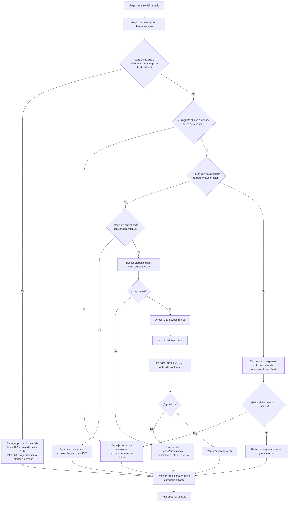

# Actividad 5 — Diagrama de flujo

El proceso que sigue el asistente en cada mensaje. El orden de evaluación es la clave de seguridad: **crisis → escalado → consentimiento → intención/respuesta**. La regla más protectora corta antes.

## Descripción en texto (por si no se renderiza el diagrama)

1. **Llega el mensaje** del usuario por el chat web y se registra.
2. **Crisis (primero):** si hay señales de crisis/riesgo, se entrega el protocolo (líneas 123 y 106), se detiene el agendamiento y se alerta a una persona. Nada tiene prioridad sobre esto.
3. **Escalado:** preguntas clínicas, menores/acudientes o temas fuera de alcance → mensaje neutro de derivación a una persona.
4. **Consentimiento:** si el usuario quiere agendar, debe estar autenticado como paciente y haber aceptado el consentimiento (Ley 1581/2012). Sin eso, no continúa el flujo de datos.
5. **Disponibilidad real:** se consulta la agenda; se ofrecen de 2 a 4 cupos reales (nunca inventados). Si no hay, se ofrece lista de espera/alternativas.
6. **Re-verificación:** antes de confirmar se re-chequea que el cupo siga libre, para no duplicar reservas.
7. **Información general:** se responde solo con la base de conocimiento aprobada; si falta el dato o no es confiable, se escala.
8. **Registro:** cada turno guarda en `meta` la categoría y las banderas (crisis/escalado) para trazabilidad.
9. **Respuesta** al usuario.
